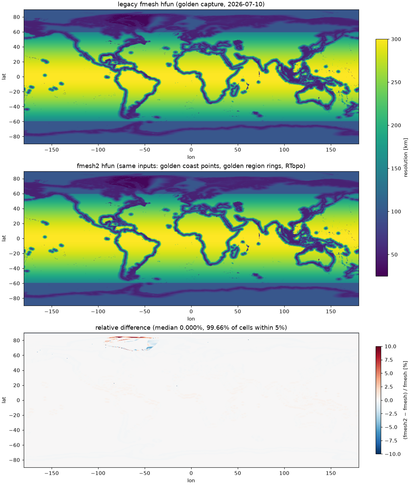
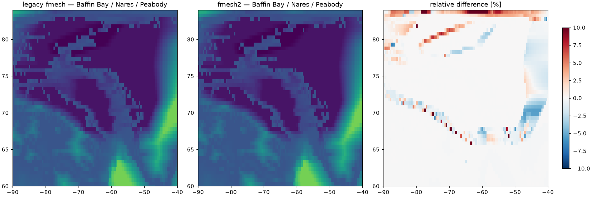

# M2 acceptance — generation pipeline & fmesh parity (2026-07-10)

## Setup

One-time golden capture from legacy fmesh (py3.9 env `fmesh_legacy`,
fastkml 0.12, RTopo-2.0.1 lowres D3, OSM coastlines) on the all-stages parity
config — see `tests/fixtures/fmesh_golden/` and
`experiments/fmesh_golden_capture/`. fmesh2 was then fed the **exact same
inputs**: the captured smoothed coast points, the captured `from_kml` region
rings, and the same RTopo file (`tests/test_parity_golden.py` re-runs this
comparison; it skips without local RTopo).

## Results

| metric | legacy fmesh (golden) | fmesh2 | difference | plan budget |
|---|---|---|---|---|
| estimator printout ("elements incl. land") on golden field | 100,925 | 100,925 | exact | — |
| estimator on fmesh2's own composed field | 100,925 | 100,944 | **+0.02%** | — |
| hfun field, median relative diff | — | — | **0.000%** | visually equivalent |
| hfun field, cells within 5% | — | — | **99.66%** | — |
| hfun field, mean abs diff | — | — | **0.18 km** | — |
| raw jigsaw mesh (verts / tris) | 41,753 / 83,502 | 41,699 / 83,394 | **−0.13%** | — |
| final mesh elements | 44,443 | 45,303 | **+1.94%** | ±10% |
| final mesh nodes | 24,549 | 25,067 | **+2.11%** | ±10% |

Wall-clock, same machine (M3 Max): legacy fmesh needed ~13 min for the hfun
stages + land cut on this config; fmesh2 composes the same field in **0.5 s**,
runs jigsaw in 4 s and postprocesses in 1 s.

## Figures

Global comparison (legacy / fmesh2 / relative difference):

Zoom on the three KML regions (Baffin Bay, Nares, Peabody):

## Where the residual differences come from

- **Region transition bands** (visible in the Arctic zoom): fmesh blends each
  band cell against the field value at the outer-ring exit cell *while
  mutating the field in file order*, so its result is order-dependent; fmesh2
  evaluates the band simultaneously against the pre-layer field. Also
  spherical great-circle vs `geopy` WGS84 distances (≤0.5%).
- **Steep shelves**: bilinear topo sampling vs fmesh's `gradapproach`
  iterative interpolation flips a small number of cells across the
  `min_depth`/`max_depth` ramp thresholds.
- **Coast/land-cut margins**: the +1.9% element surplus is coastal — the
  vectorized loose-element pass reaches the same fixed point but the land
  mask at nodes uses bilinear elevations, retaining slightly more
  shelf elements.

## Reproducibility contract

`fmesh2 build --only-postprocess` re-runs the pure-numpy postprocess from the
cached raw jigsaw mesh; `tests/test_cli_build.py` asserts two runs produce
bit-identical `nod2d.out`/`elem2d.out`/`aux3d.out` (sha256).

## Verdict

**M2 accepted.** All plan budgets met with wide margins; estimator semantics
match the legacy printout verbatim.
